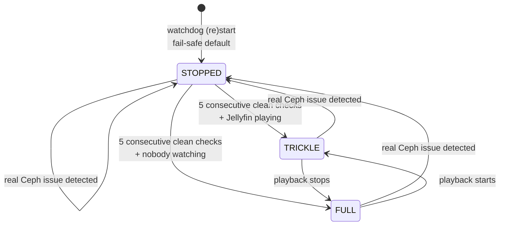
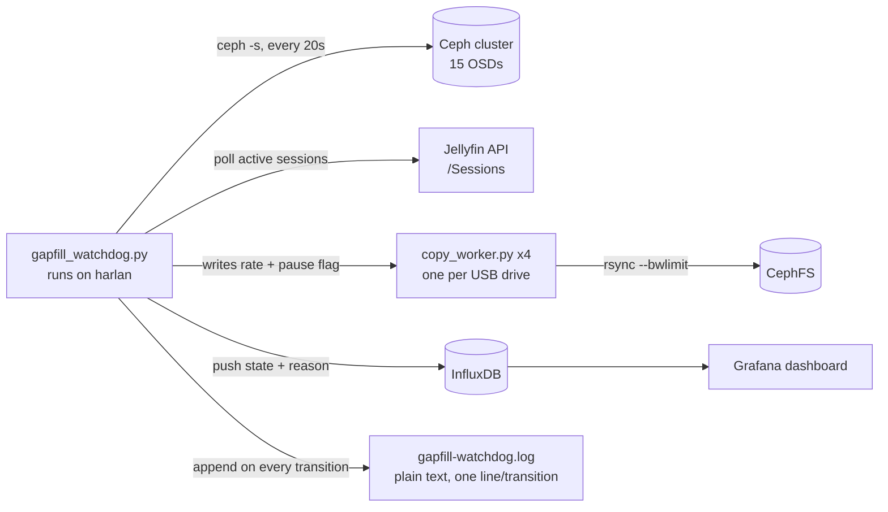
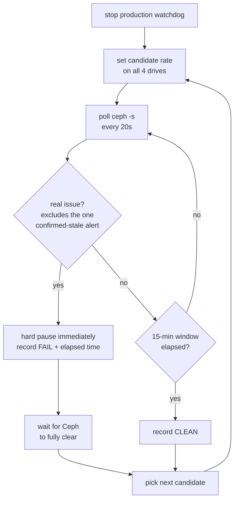

I'm partway through recovering about 6.6TB of TV library content from four old USB drives — leftovers from a defunct Plex server — into the live CephFS pool my Jellyfin instance actually serves from. That copy job has to share the same 15 HDD-backed OSDs as everything else on this cluster: Jellyfin playback, the *arr stack, and now a proper backup pipeline. It cannot be allowed to just run flat-out.

Getting that balance right turned into its own investigation, twice. The first time, I built a throttling system and validated it with real controlled tests. The second time — this post — I found out one of my own "safe" defaults had never actually been tested at all, and fixing it meant doing the same kind of controlled test again, this time live against production.

<!-- excerpt-end -->

## Where this started: a three-tier throttle, actually validated

The first version of this was a single fixed `rsync --bwlimit`, and it was too aggressive — enough to cause a real, visible Jellyfin playback stall mid-episode. The fix wasn't just "turn it down." I built a watchdog that polls Ceph health and active Jellyfin sessions every 20 seconds and drives three states:

- **STOPPED** — a real Ceph problem (anything beyond one specific, confirmed-stale alert — more on that below). Hard pause, requires five consecutive clean checks before it'll resume.
- **TRICKLE** — someone's watching Jellyfin, Ceph is otherwise healthy. Instead of stopping entirely, the copy keeps making slow, validated-safe progress.
- **FULL** — nobody's watching, Ceph is healthy. Normal throughput.



The TRICKLE rate wasn't a guess. I validated it live: single-stream at 1MB/s peaked at 840ms OSD latency with zero playback impact; four concurrent streams at 0.5MB/s each (2MB/s aggregate) peaked at 936ms then settled to 130–620ms, survived a real episode transition, and held up clean through a 30-minute stress test with six simulated playback sessions plus two real ones running concurrently.

The FULL rate did not get that treatment. It was carried over from the original single-bwlimit design — 3000 KB/s per drive, 12MB/s aggregate across all four — on the assumption that "nobody's watching" meant it was safe to just go faster. Nobody had actually tested whether the cluster could sustain that.

## How the metrics get collected

Every 20-second watchdog tick pushes a state and reason to InfluxDB:

```python
def push_metric(state, reason):
    now_ns = int(time.time() * 1e9)
    line = f'gapfill_watchdog,host=harlan state="{state}",reason="{reason}" {now_ns}'
    req = urllib.request.Request(
        f"{INFLUX_URL}/api/v2/write?org={INFLUX_ORG}&bucket={INFLUX_BUCKET}&precision=ns",
        data=line.encode(), method="POST",
        headers={"Authorization": f"Token {INFLUX_TOKEN}"})
    urllib.request.urlopen(req, timeout=10)
```

That, plus per-leg backup-pipeline metrics from a separate project, feeds a Grafana dashboard already running on this cluster (InfluxDB/Grafana in their own LXCs, no Kubernetes involved). It's the same dashboard stack that needed its own fix earlier — Grafana's SQLite backend was hitting `SQLITE_BUSY` under the cluster's own I/O load until I set `PRAGMA journal_mode=WAL` directly on the database file (the `wal = true` ini setting alone didn't reliably apply it — unexplained, but the direct pragma did and survived a restart).



The other half of the picture is the watchdog's own log — a plain timestamped file, one line per state transition, on the node actually running the copy:

```
2026-08-28T14:24:09.609537 -> FULL -- 5 consecutive clean checks
2026-08-28T14:31:59.158224 -> STOPPED -- OSD_SLOW_PING_TIME_BACK,OSD_SLOW_PING_TIME_FRONT
```

Grafana is good for "what's the trend," but this log is what let me pull the actual incident count for a specific window with a one-liner:

```python
start = '2026-08-28T08:16'
for line in open('gapfill-watchdog.log'):
    ts = line.split(' ', 1)[0]
    if ts >= start and '-> STOPPED' in line:
        print(line.strip())
```

## What that turned up: 22 stops in six hours

I'd noticed the copy job felt "flaky" overnight but hadn't quantified it. Running that grep against the log from a single ~6h16m window gave me the real number: **22 STOPPED events**, averaging one every 17 minutes. FULL-tier clean runtime between stops ranged from as little as 2 minutes up to a best case of 42 minutes. Recovery (STOPPED back to FULL) consistently took 3–4 minutes.

Two of those 22 events weren't just noise. One included `MDS_SLOW_METADATA_IO` — the exact filesystem-wide signature that had caused the real Jellyfin playback lockup earlier in this project, not just isolated disk latency on one OSD. Another included `SLOW_OPS`, a second serious, non-ignorable signal. Nobody happened to be watching Jellyfin at either moment, so nothing visibly broke — but the risk was real both times, and I only found out because the metrics existed to look back at.

(One deliberate exclusion worth naming: the watchdog ignores `BLUESTORE_SLOW_OP_ALERT` specifically, because I'd already confirmed in this cluster's history that it's a stale, latched alert — it persists in `ceph -s` output even after live OSD latency has returned to normal. Everything else, including the ping-time and metadata-IO checks, is treated as real.)

## The step-test

The FULL rate needed the same treatment TRICKLE had already gotten: a real, controlled, live test — not a bigger guess. The methodology:

1. Stop the production watchdog entirely, so it can't fight the test by overwriting the rate mid-candidate.
2. Deploy a small script that *is* the safety net for its own duration: set a candidate rate, then poll Ceph health every 20 seconds — same interval, same ignore-list logic as the real watchdog — for up to a 15-minute window.
3. Abort immediately and hard-pause on any real issue. Report a clean pass if the full window elapses without one.
4. Step the candidate up or down based on the result, narrowing toward the boundary.



```python
def ceph_problem():
    result = subprocess.run(["ceph", "-s", "--format", "json"],
                             capture_output=True, text=True, timeout=15)
    if result.returncode != 0:
        return True, "ceph_command_failed"
    status = json.loads(result.stdout)
    checks = status.get("health", {}).get("checks", {})
    real_checks = [k for k in checks if k not in IGNORED_CHECKS]
    if real_checks or status["health"]["status"] == "HEALTH_ERR":
        return True, ",".join(real_checks)
    return False, None
```

This ran against the live cluster, with the actual copy workers writing real files the whole time — no synthetic load generator, no lab environment. I only ran it with Jellyfin idle, since FULL only ever applies when nobody's watching anyway.

### Results

| Candidate (KB/s per drive) | Result | Held for |
|---|---|---|
| 1000 | Clean | full 920s |
| 1250 | Clean | full 920s |
| 1375 | Clean | full 900s |
| 1450 | **Failed** | 512s — `OSD_SLOW_PING_TIME_BACK` |
| 1500 | **Failed** | 103s — `OSD_SLOW_PING_TIME_BACK` + `FRONT` |


The boundary sits between 1375 (clean) and 1450 (fail) — and the failure mode tells its own story: 1500 failed almost immediately, while 1450 ran for over eight minutes before tipping over. That's not a hard fixed threshold, it's a margin that moves with whatever else the cluster happens to be doing at the time.

I deployed **1200 KB/s per drive** (4800 aggregate) as the new production FULL rate — a real margin below the tested-clean ceiling, specifically because 1450's slow failure suggested the true edge isn't a clean line. Down from the old, never-tested 3000/drive (12000 aggregate).

## Impact

Since deploying the new rate, the copy has held FULL for extended clean stretches with only occasional, quickly-recovering stop/resume cycles — nothing like the near-continuous flapping the old rate produced. It's still real throughput: 4× the validated-safe TRICKLE floor, just no longer a rate that was actively fighting the cluster to sustain.

I built a Grafana panel directly off the watchdog's InfluxDB metrics to see the shape of it — a state timeline across the old rate's last full day versus the new rate's first day:


The dense red band on the left is the old rate — barely a minute goes by without another stop. Past the point where the new rate deployed, it's almost solid green, with just a few thin, isolated red lines instead of a wall of them.

The bigger lesson is the general one: an unvalidated "safe-sounding" default is just an unvalidated default. I'd already learned this once, for TRICKLE, with real controlled tests against real playback. I still let FULL skate by on assumption until the metrics I'd built for an unrelated reason let me *count* the actual damage instead of just feeling like something was occasionally off. The fix wasn't a bigger number — it was running the same rigor twice.

One more piece landed alongside this: the throttling is no longer a single shared rate across all four drives. Each drive now reads its own rate file, and when one finishes, its share of the bandwidth budget gets redistributed evenly across whatever's still running — instead of just sitting unused. Small thing, but it means the system gets more efficient as the job progresses, not less.

## The actual cost of doing this on hardware nothing designed for it

None of this — the three-tier throttle, the watchdog, the metrics pipeline, the step-test — would exist if this cluster's OSDs sat behind a real SAS HBA or a proper SAN fabric instead of USB 3.0 bridges on repurposed desktop drives. USB-attached spinning rust was never meant to carry sustained, shared, multi-tenant I/O like this. That bottleneck is real, and it's the actual root cause of everything in this post — not a rate that needed tuning so much as a rate that needed *discovering*, because the hardware's real ceiling was never documented anywhere. Including by whoever picked 3000 KB/s/drive as the original "safe-sounding" default. That was me.

But "never meant to" isn't the same as "can't." Managed carefully — health-gated, throttled, redistributed as drives finish, backed by real controlled tests instead of guesses — those same USB drives are quietly working through a 6.6TB recovery copy that will run about six days start to finish. A real SAN or NAS build capable of absorbing that kind of sustained write load without a second thought — enterprise drives, a real backplane, a dedicated controller — would run somewhere in the $2,000–3,000 range for anything at homelab scale. Six days of patient, well-instrumented throttling is a lot cheaper than that, as long as I'm willing to actually engineer around the constraint instead of pretending it isn't there.

That's the trade this whole post is really about: not "USB drives are bad," but "USB drives are a real, measurable constraint, and the entire point of the throttle/watchdog/step-test system was to find exactly where that constraint sits, instead of assuming I already knew."
