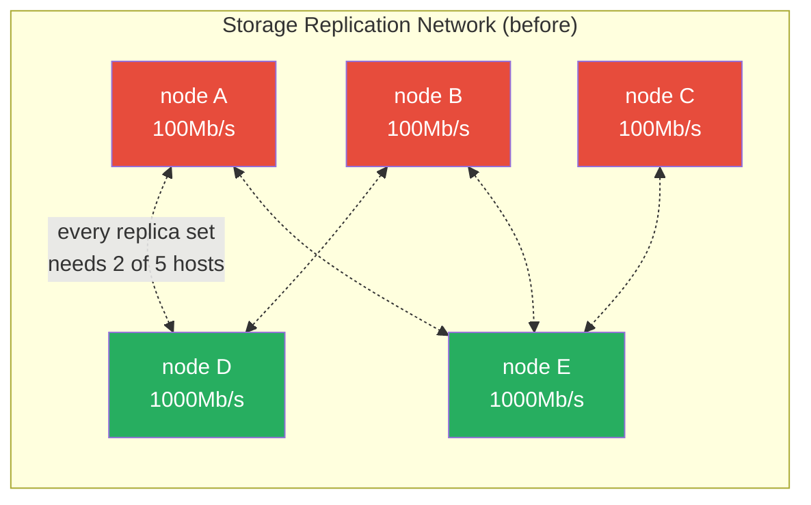
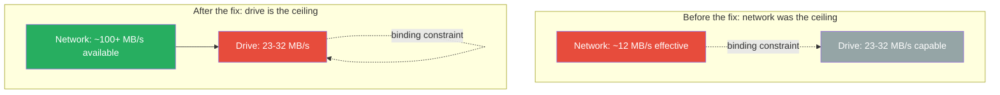

Raleigh gets power outages during wind storms — the neighborhood still runs on above-ground lines from the 1960s-70s, and it shows. The most recent one took my whole six-node Proxmox/Ceph cluster down at once. Five nodes came back on their own within about 17 seconds of each other. The sixth — `tanaka`, a Dell OptiPlex 390 that only ever ran a Ceph monitor and manager, no storage — never came back at all.

<!-- excerpt-end -->

## The node that didn't come back

`tanaka` carries zero OSDs — it's mon+mgr only in my Ceph topology, so its loss didn't put any actual data at risk. But losing one of six monitors still shrinks quorum tolerance, and it's not a node I want sitting dark indefinitely.

When I finally got hands-on with it, the diagnosis wasn't subtle: front power button completely dead, no response at all. The power supply's own test button lit the case LED solid amber — no video, no keyboard or mouse activity, nothing reaching POST. Per Dell's own diagnostic reference, solid (non-blinking) amber means the power supply's standby rail is fine but the board never gets past that point. A press-and-hold *did* force a shutdown and a subsequent press restarted it — so the switch and its cable are actually fine, which at least ruled that out. Reseated the RAM, reseated the main power connector, no change. No spare PSU on hand to swap-test with.

My working diagnosis is a PSU-under-load failure or a motherboard fault — not something worth chasing further on a nine-year-old office PC. I'll poke at it a little more out of curiosity, but its most likely future is a parts listing on eBay.

## The bottleneck that had been there the whole time

Losing `tanaka` is what got me back into the cluster's guts, and while I was in there, something else surfaced — the kind of thing that's very easy to miss because nothing about it looks broken on the surface.

Ceph's dedicated storage-replication network runs across all five of my OSD-carrying nodes. Two of them were running that link at a full gigabit. **Three of them were running it at 100Mb/s** — a leftover Fast Ethernet card from years ago that nobody had specifically flagged as Ceph-relevant, because "it's an old machine with an old NIC" doesn't announce itself as "this is capping your entire storage cluster."

With three-way replication and only two of five hosts on the fast network, this wasn't an occasional slowdown — it was structurally guaranteed. Every single write to the cluster, no matter which drives happened to hold its replicas, was forced to cross at least one of those 100Mb links. It had been true for months. It just took a night with real, sustained cluster load for it to become undeniable — a background job I had running against the cluster correctly noticed things were badly degraded and stopped itself rather than push through it, which is exactly the kind of safety behavior you want and also exactly the kind of thing that makes you go looking for what's actually wrong.

Here's the topology that made it unavoidable — five OSD hosts, three-way replication, and only two of five nodes on the fast path:

With replicas placed across any 3 of these 5 hosts, and 3 of the 5 stuck at 100Mb/s, there is no possible placement that avoids touching at least one slow node. That's not bad luck on any given write — it's a guarantee baked into the topology.

## The fix that didn't wait for shipping

The "correct" fix — new gigabit NICs in the same slot as the old 100Mb cards — meant ordering hardware and waiting. I bought the cards (Compaq NC7170 gigabit adapters, the same model already working fine on two other nodes in the fleet), but didn't want to leave the cluster degraded for a week waiting on eBay.

It turned out all three affected machines already had a second gigabit NIC sitting completely idle in a PCIe slot — cabled to nothing, never used for anything. So the fix that actually happened, the same night, was just moving each machine's storage-network cable over to the port that was already there. Zero dollars, zero lead time, and arguably better than the original plan — it puts those three nodes fully off the old shared legacy PCI bus instead of just matching the gigabit speed of the machines that also share that same bus. The NC7170 cards I already bought are now spares.

Real numbers, measured directly before and after with `iperf3`:

| Path | Before | After |
|---|---|---|
| Node A → healthy node | 93 Mbit/s | 842 Mbit/s |
| Node B → healthy node | 94 Mbit/s | 838 Mbit/s |
| Node C → healthy node | 5–43 Mbit/s, with real packet retransmits | 849 Mbit/s, zero retransmits |

That third row is the one that mattered most in practice — before the fix, that link wasn't just slow, it was actively dropping and resending packets under real load. After, it's clean.

```mermaid
xychart-beta
    title "Storage Network Throughput, Before vs After (Mbit/s)"
    x-axis ["Node A", "Node B", "Node C"]
    y-axis "Mbit/s" 0 --> 900
    bar [93, 94, 24]
    bar [842, 838, 849]
```

*(Node C's "before" bar uses the midpoint of its 5-43 Mbit/s range — the real number bounced around under load, with actual retransmits, which a single bar can't fully capture.)*

I also ran a real end-to-end Ceph benchmark afterward (something I'd genuinely never done before, worth admitting) — actual client writes and reads through the full replication path, not just a raw network test. And to make sure I wasn't fooling myself about *why* writes landed where they did, I re-ran the same drive-level write test I'd used weeks earlier to originally measure the drive ceiling, on the same two drives:

| Test | Before | After | What changed |
|---|---|---|---|
| Network throughput (per node) | 93-94 Mbit/s (worst: 5-43 with retransmits) | 838-849 Mbit/s | Network — fixed |
| Drive-local write ceiling, node A's OSD | 25.5 MB/s | 31.99 MB/s | Roughly flat — same drive, same ceiling, normal run-to-run variance |
| Drive-local write ceiling, node D's OSD | 22.8 MB/s | 27.07 MB/s | Roughly flat — same drive, same ceiling |
| Real client write (full replication path) | never measured — structurally impossible above ~11.6 MB/s given the network cap | **39.17 MB/s** | New number, only possible once the network stopped being the limit |
| Real client read (full replication path) | never measured — same ~11.6 MB/s structural cap | **120.86 MB/s** | New number, essentially full drive speed |

The drive-local numbers are the control group here — they don't touch the network at all, so if they'd jumped too, I'd have been suspicious I was measuring something else by accident. They didn't jump. They stayed exactly where a mechanical drive with a fixed write ceiling should stay, before and after a completely unrelated network fix. That's what tells you the bottleneck actually moved layers, rather than just "got better" for some vaguer reason:

- **Read: 120.86 MB/s** — close enough to my drives' independently-measured raw read speed that reads are now running at essentially full disk speed. The network is completely out of their way.
- **Write: 39.17 MB/s** — lower, and that's the *good* kind of lower. Writes are now bottlenecked by the drives, not the network. That's the right bottleneck to have.

## Why the drives are the bottleneck now: SMR, and what I traded for a good price

Every OSD drive in this cluster is a Seagate 5TB 2.5" external — the kind sold as a "portable drive," not marketed for NAS or server duty. What that product category doesn't advertise clearly is that they're **SMR: Shingled Magnetic Recording**.

A normal hard drive (CMR — Conventional Magnetic Recording) writes data in discrete tracks with a small gap between them, so any track can be rewritten independently at any time. SMR drives overlap those tracks like shingles on a roof, each one covering part of the next, to pack noticeably more data onto the same physical platters — which is exactly why they're cheaper per terabyte. The catch is in the name: you can't rewrite one shingled track without disturbing the ones partially overlapping it. Consumer SMR drives hide this from the OS with a small conventional (non-shingled) cache zone up front and a firmware translation layer that shuffles data around in the background — invisible for light, bursty use, but a real cliff once you sustain writes past that cache, because the drive then has to read, modify, and rewrite entire overlapping bands instead of a single track.

That's a rough description of exactly what Ceph does to a drive all day: a steady stream of small, often-random writes from replication traffic, metadata updates, and background scrubbing. It's a genuinely bad match for SMR's strengths, and it's the direct cause of the ~23-32 MB/s write ceiling in the table above — a number that's remarkably consistent with what other people running Ceph on this exact drive family have measured and written about.

It's worth being honest about where that ceiling came from, because it wasn't an accident I didn't know about — it was a price I chose to pay. The early batch of these drives came from a Costco special at around $85 for 5TB, and later ones from Amazon/Seagate sales around $110 — both well under half the going rate at the time for drives explicitly rated for sustained, always-on, NAS-style workloads. That price gap *is* the SMR trade-off, priced in: cheaper, higher-density platters in exchange for exactly the write behavior described above. I looked at the better-suited (and more expensive) drives when I built this out and decided the cost difference wasn't one I could justify for a homelab media server — capacity-per-dollar won over write consistency, with my eyes open about the tradeoff at the time, if not about every consequence of it.

One of those consequences showed up again this same night, on a completely unrelated drive: a SMART attribute called `Command_Timeout` with a real historical count, plus a marginal note on operating temperature. Nothing about that drive is actually failing — reallocated and pending sector counts are both zero, the clean signal you actually want — but a drive that occasionally reports a command taking longer than expected, under a workload of sustained small random writes, is exactly the "screwy SMART" signature this drive family is known for. It's the SMR write penalty showing up as a monitoring artifact instead of as a slow benchmark number — same underlying cause, different symptom.

None of this makes SMR the wrong choice for this project. It made a 75TB usable Ceph cluster affordable in the first place. But it's the second bottleneck in this story, and unlike the network one, it's not something I'm going to "fix" — it's a tradeoff I already made on purpose, now just visible with real numbers behind it instead of a hunch.

## The hardware shopping trip

Fixing `tanaka` turned into upgrading it. I bought two used Dell OptiPlex 990s — bare, no drives, no RAM, but with the same 4-core i7 generation CPU already running the rest of the fleet, so it slots in as a peer rather than an odd one out. The plan for getting `tanaka` back:

- Try a straight boot-disk transplant from the dead 390 into one of the 990s first, along with moving its network cards over, before falling back to a from-scratch reinstall. Linux is generally forgiving about hardware changes underneath an existing install — the one real gotcha I already know to expect is that network interface names are tied to PCI topology, so they'll almost certainly rename themselves on the new board, meaning `/etc/network/interfaces` needs a quick fix after first boot. Not a blocker, just a known step.
- Add a new USB3 controller card to the mix, specifically so `tanaka` can carry real OSD drives going forward — something it's never done.

That's the bigger plan, not just a repair: **`tanaka` gets promoted from mon-only to a full storage node within the next couple of weeks**, going from "the node that doesn't really do anything if it's down" to genuinely sharing the storage load like the other five.

## More eyes on the cluster going forward

Part of what made this bottleneck invisible for so long is that I simply wasn't measuring it. Since the outage, I've been adding real metrics specifically so this class of problem surfaces on a dashboard instead of by accident: link speed and status per node/interface, drive health and reallocated-sector counts, and usage/gap tracking across the media library so I can see what's actually missing instead of assuming the library is complete. The goal is that the next version of this story is a Grafana panel turning red, not a background job dying with no explanation and a night of manual digging.

## The silver lining

It's a strange thing to say about a power outage, but this one was fortunate in a few real ways. It killed a machine that was, it turns out, already on its way out — better to find that out now than mid-failure during something more important. It forced me to actually load-test the cluster hard enough that a months-old, structural bottleneck stopped being theoretical and became something I could measure, diagnose, and fix in a single evening using hardware I already owned. And it's turning into a net upgrade — `tanaka` comes back not as a restored mon-only box, but as a real storage node, on better networking than it would have had if none of this had ever happened.

Sometimes the outage is the nudge you needed.
