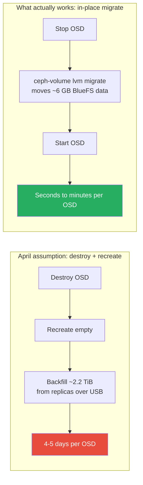

Back in April I [benchmarked WAL vs DB acceleration](/ceph-wal-vs-db-performance-test/) on this cluster and landed on a clear recommendation: **don't bother converting the nine WAL-only OSDs to DB.** The measured performance gap was real but modest — 5-15% on matched hardware — and the only conversion path I knew of was destroy-and-recreate, which meant backfilling roughly 2.2 TiB per OSD over USB 3.0. At ~13 MiB/s sustained, that penciled out to 4-5 days per OSD, or 36-45 days of maintenance windows to convert all nine. Not worth it for a 10% latency improvement.

This week a recurring `DB_DEVICE_STALLED_READ_ALERT` sent me back into the exact same nine OSDs. This time I found a tool that makes that whole estimate wrong — and by the end of it I'd converted and right-sized all **eighteen** OSDs across all six nodes, in an afternoon, with two full reboot tests to prove it stuck.

This post is both the story and a complete, copy-pasteable procedure — including a real bug in `ceph-volume` that I couldn't find documented anywhere before hitting it myself, nine times in a row.

<!-- excerpt-end -->

## Why I Was Back Here At All

`HEALTH_WARN` showed up with `BLUESTORE_SLOW_OP_ALERT` and `DB_DEVICE_STALLED_READ_ALERT` on osd.0 (harlan) and osd.2 (kovacs) — the same alert pattern that had shown up once before, briefly, back in August. This time it wasn't a one-off. Digging through `journalctl` turned up real stalled-read events clustered across two consecutive days — 56, 23, and 77 occurrences on harlan's three OSDs, 26 on kovacs' osd.2, zero anywhere else in the cluster:

```
bdev(...osd-0/block) read_random stalled read 0x3fbd68f457c~1017 (buffered) since 690177.869964s, timeout is 5.000000s
```

That log line is the whole story in one line: a BlueFS metadata read against the *main HDD block device* — not a dedicated DB device — taking longer than Ceph's 5-second stall threshold. Which meant one thing: this was the exact WAL-only-vs-DB split from April, now causing real, user-visible stalls instead of just a modest benchmark gap.

## The Foundation: Getting to Squid First

None of this week's work would have been possible without a piece of groundwork laid back in August — upgrading the cluster's Ceph version from Reef (18.2.8) to Squid (19.2.5), done specifically to clear a hard blocker for the still-pending Proxmox VE 8→9 (Debian 13 "Trixie") upgrade. Proxmox's own `pve8to9` checker refuses to proceed with Ceph Reef in the mix — Squid is a prerequisite, not an optional nice-to-have.

That upgrade ran as its own phased project: canary nodes first (tanaka, then quell — mon/mgr, then OSDs), full quorum health checks between every step, then the remaining four nodes, then a monitor daemon restart cycle to bring CephFS's 6 standby MDS daemons back onto Squid, and finally `ceph osd require-osd-release squid` to close it out. Zero data loss, zero unplanned downtime, `HEALTH_OK` at every gate. The cluster's OS itself is still on PVE 8.4/Debian 12 — the actual Trixie jump is a separate, still-pending phase that needs physical presence at every node, since none of this hardware has out-of-band management. Decoupling the Ceph upgrade from the OS upgrade was deliberate: get the storage layer current and stable first, worry about the host OS separately.

I mention all this because it matters for what comes next: the tool that made this week's fix cheap isn't new to Squid — as far as I can tell it's been in `ceph-volume` since well before Reef. I just didn't know to look for it in April. The Squid upgrade gave me a clean, current baseline to diagnose from; it wasn't the thing that unlocked the fix. Worth being precise about that distinction rather than crediting the wrong upgrade for the right result.

## The Tool I Didn't Know About: `ceph-volume lvm migrate`

The April benchmark's cost estimate assumed the only way to change an OSD's WAL/DB layout was `ceph-volume lvm create` from scratch — destroy the OSD, recreate it pointing at a new device, let Ceph backfill the entire thing from replicas. That's genuinely expensive on USB-attached spinning disks.

`ceph-volume lvm migrate` does something completely different: it moves BlueFS's *internal* data — the actual WAL/DB content, not the OSD's object data — from one device to another, live, without touching a single RADOS object. I confirmed this before trusting it with production data: actual measured BlueFS DB usage on these OSDs, even at 75-80% full, was only **5.3-7.1 GB per OSD** — not the 2.2+ TiB of object data the April estimate was built around.

```bash
ceph-bluestore-tool bluefs-bdev-sizes --path /var/lib/ceph/osd/ceph-6
# 1 : device size 50 GiB : using 5.5 GiB   <- the DB/WAL, this is what actually moves
# 2 : device size 4.5 TiB : using 3.4 TiB  <- the object data, this never moves
```

Copying 5-7 GB locally between two devices on the same host takes seconds, not days. That's the entire reason the April math doesn't hold anymore.



There are actually **two different situations** this tool handles, and they behave very differently in practice. I hit both this week, on nine OSDs each.

## Path A: Converting a WAL-Only OSD to Combined WAL+DB

This is what harlan, kovacs, and quell needed — nine OSDs where the SSD only held the WAL, and BlueStore's DB was silently living on the HDD.

### The command

```bash
FSID=$(cat /var/lib/ceph/osd/ceph-$N/fsid)
lvcreate -y -L 50G -n osd-dbwal-$N <ssd-vg>
systemctl stop ceph-osd@$N
ceph-volume lvm migrate --osd-id $N --osd-fsid $FSID --from data wal --target <ssd-vg>/osd-dbwal-$N
```

`--from data wal` tells the tool to pull the DB data (currently embedded in the main `data` device, since there was never a dedicated DB device) *and* the existing WAL LV into one new combined target. Per `ceph-volume`'s own documented precedence rules, sourcing a WAL volume without a DB volume means the target replaces the WAL role — so you end up with one right-sized LV doing both jobs, matching the architecture Ceph recommends.

### The bug — hit on 9 out of 9 OSDs

Every single conversion failed the same way:

```
--> Migrate to new, Source: ['--devs-source', '.../block.wal', '--devs-source', '.../block'] Target: ...
Running command: /usr/bin/chown -R ceph:ceph /var/lib/ceph/osd/ceph-6/block.wal
 stderr: /usr/bin/chown: cannot access '/var/lib/ceph/osd/ceph-6/block.wal': No such file or directory
--> Undoing lv tag set
-->  RuntimeError: command returned non-zero exit status: 1
```

**The actual BlueFS data migration succeeds every time.** `ceph-volume` correctly consolidates the WAL and the HDD-embedded DB data onto the new target LV — that part of the tool works. But its own cleanup step then tries to `chown` a `block.wal` symlink that no longer exists (the migration already replaced it with `block.db`), that command fails, and the tool's exception handler strips the LVM tags it had just set on the new device — without restoring the old ones. The result: an OSD whose data is correctly migrated but whose device has zero `ceph.*` metadata tags, so `ceph-osd` can't open it and crash-loops with `_minimal_open_bluefs ... symlink exists but target unusable: (13) Permission denied`.

I'm running Ceph Squid 19.2.5 via Proxmox VE 8.4. If you're on a different version, I'd genuinely like to know whether this reproduces — I couldn't find this specific failure documented anywhere before hitting it myself, which is a big part of why this post exists.

### Verify before you touch anything

Before trusting any repair, confirm the data actually landed safely:

```bash
ceph-bluestore-tool bluefs-bdev-sizes --path /var/lib/ceph/osd/ceph-$N
# Should show two devices: the new ~50GB one with a few GB "using", and the
# multi-TB HDD with your real data usage — if both look sane, the data moved fine.

ceph-bluestore-tool fsck --path /var/lib/ceph/osd/ceph-$N
# "fsck success" is the real green light. Can take a couple minutes on a full OSD.
```

Both came back clean on all nine OSDs, every time. The bug is in the tool's bookkeeping, not in the actual data path.

### The fix

Manually re-tag both the OSD's block LV and the new combined LV to match the schema `ceph-volume` expects. I cross-referenced the exact tag set from a working DB-configured OSD elsewhere in the cluster (`lvs -a -o lv_tags <vg>/<lv>` on one of edgar's OSDs) rather than guessing at it.

```bash
# Read the block LV's CURRENT (stale) tags first to get the old wal_device/wal_uuid values
lvs -a -o lv_name,lv_tags <block-vg>/<block-lv-name>

# Get the new target LV's own UUID
lvs --noheadings -o lv_uuid <ssd-vg>/osd-dbwal-$N

# 1. Fix the block LV: remove the stale wal reference, add the real db reference
lvchange --deltag "ceph.wal_device=<old-wal-lv-path>" \
         --deltag "ceph.wal_uuid=<old-wal-uuid>" \
         <block-vg>/<block-lv-name>
lvchange --addtag "ceph.db_device=<new-lv-path>" \
         --addtag "ceph.db_uuid=<new-lv-uuid>" \
         <block-vg>/<block-lv-name>

# 2. Tag the new LV with the full schema a db device needs
lvchange --addtag "ceph.block_device=<block-lv-path>" \
         --addtag "ceph.block_uuid=<block-lv-uuid>" \
         --addtag "ceph.cephx_lockbox_secret=" \
         --addtag "ceph.cluster_fsid=<cluster-fsid>" \
         --addtag "ceph.cluster_name=ceph" \
         --addtag "ceph.crush_device_class=" \
         --addtag "ceph.db_device=<new-lv-path>" \
         --addtag "ceph.db_uuid=<new-lv-uuid>" \
         --addtag "ceph.encrypted=0" \
         --addtag "ceph.osd_fsid=<osd-fsid>" \
         --addtag "ceph.osd_id=$N" \
         --addtag "ceph.osdspec_affinity=" \
         --addtag "ceph.type=db" \
         --addtag "ceph.vdo=0" \
         <ssd-vg>/osd-dbwal-$N

# 3. Let ceph-volume reapply device ownership from the now-correct tags, and start the OSD
ceph-volume lvm trigger $N-<osd-fsid>
```

Step 3 is doing real work — it's not just a restart. It re-primes `/var/lib/ceph/osd/ceph-$N/` from the LV tags, fixes device ownership (`chown ceph:ceph`), re-links the symlinks, and starts the daemon:

```
Running command: /usr/bin/chown -R ceph:ceph /var/lib/ceph/osd/ceph-6
Running command: /usr/bin/ceph-bluestore-tool --cluster=ceph prime-osd-dir --dev ... --path ...
Running command: /usr/bin/ln -snf ... /var/lib/ceph/osd/ceph-6/block.db
Running command: /usr/bin/chown -h ceph:ceph ...
Running command: /usr/bin/systemctl enable ceph-volume@lvm-6-<fsid>
Running command: /usr/bin/systemctl enable --runtime ceph-osd@6
Running command: /usr/bin/systemctl start ceph-osd@6
--> ceph-volume lvm activate successful for osd ID: 6
```

Nine for nine, this exact sequence fixed it every time. Give it 30-60 seconds after starting before checking `ceph osd metadata $N` — the daemon needs a moment to register the new device with the monitors, and `ceph -s` will briefly show the OSD as down during that window. That's normal registration lag, not a second failure; check `journalctl -u ceph-osd@$N` to confirm a single clean boot with `NRestarts=0`, not a crash loop.

### Cleanup

Because the buggy cleanup path never removed the old LV, it's left behind, orphaned:

```bash
lvs -a -o lv_name,lv_tags <ssd-vg>   # confirm the old osd-wal-* LV has no active references
lvremove -y <ssd-vg>/<old-wal-lv-name>
```

## Path B: Right-Sizing an Already-Correct DB OSD

This is what edgar, poe, and tanaka needed — nine OSDs that already had DB (not WAL-only) correctly on the SSD, just sized at the original 100GB instead of a more realistic 50GB.

### The command

```bash
FSID=$(cat /var/lib/ceph/osd/ceph-$N/fsid)
lvcreate -y -L 50G -n osd-dbwal-$N <ssd-vg>
systemctl stop ceph-osd@$N
ceph-volume lvm migrate --osd-id $N --osd-fsid $FSID --from db --target <ssd-vg>/osd-dbwal-$N
systemctl start ceph-osd@$N
```

**This path never hit the Path A bug, on any of the nine OSDs.** No `block.wal` symlink is involved when the source is already a single `db` device, so the failing cleanup step never runs:

```
--> Migrate to new, Source: ['--devs-source', '/var/lib/ceph/osd/ceph-12/block.db'] Target: ...
Running command: /usr/bin/chown -h ceph:ceph /var/lib/ceph/osd/ceph-12/block.db
Running command: /usr/bin/chown -R ceph:ceph /dev/dm-6
--> Zapping: /dev/<ssd-vg>/<old-db-lv-name>
--> Removing all BlueStore signature on /dev/<ssd-vg>/<old-db-lv-name> if any...
--> Zapping successful for: <LV: /dev/<ssd-vg>/<old-db-lv-name>>
--> Migration successful.
```

### The wrinkle: "zapping" doesn't mean "removing"

The tool automatically wipes the old LV's BlueStore signature on success — but **does not remove the LV from LVM.** `vgs` free space won't change until you clean it up yourself:

```bash
lvs -a -o lv_name,lv_size <ssd-vg>
# The old 100GB LV is still listed — data wiped, but the space is still allocated

# Once you've confirmed (via ceph osd metadata) the OSD is running on the new device:
lvremove -y <ssd-vg>/<old-db-lv-name>
```

Also note: unlike what you might expect, `ceph-volume lvm migrate` does **not** start the OSD on success — on either path. `systemctl start ceph-osd@$N` is always a required manual step after the migrate command returns, buggy path or clean path.

## The Reclaimed Space

Every host went from three 100GB LVs to three 50GB LVs — an 8x margin over real measured usage (5-8GB), still comfortably clear of RocksDB's compaction-level spillover thresholds:

| Host | Before | After | Reclaimed |
|---|---|---|---|
| harlan | 165.76 GB free | 315.76 GB free | +150 GB |
| kovacs | 165.76 GB free | 315.76 GB free | +150 GB |
| quell | 176.94 GB free | 326.94 GB free | +150 GB |
| edgar | 176.94 GB free | 326.94 GB free | +150 GB |
| poe | 189.05 GB free | 339.05 GB free | +150 GB |
| tanaka | 176.94 GB free | 326.94 GB free | +150 GB |

**~900GB reclaimed fleet-wide** (150GB × 6 hosts), bringing total free SSD space across the fleet to **~1.95TB** — sitting idle for now, a reasonable start toward the fast-tier SSD pool idea from the original hybrid-storage article, once there's a concrete use case to size it against. (Worth being precise about that distinction: it's easy to accidentally quote the *total* free space as the *reclaimed* amount — I did exactly that in an earlier draft of the internal plan doc for this project, and I'm leaving that mislabeling note in place there rather than quietly erasing it.)

## Correcting My Own Recovery-Tuning Conclusion

The April benchmark article tried to speed up a slow backfill by bumping `osd_max_backfills` and `osd_recovery_max_active`, saw no improvement, and concluded the USB controller was the hard wall — not Ceph scheduling. That conclusion is probably still directionally right, but this week I found a wrinkle in *how* it was tested.

This cluster runs Ceph's **mClock scheduler** (Squid's default), and mClock silently overrides `osd_max_backfills`/`osd_recovery_max_active` unless you explicitly set `osd_mclock_override_recovery_settings`. I confirmed it directly — set `osd_max_backfills` to 3, watched the live daemon config, and it stayed at 1:

```bash
ceph config set osd osd_max_backfills 3   # "succeeds"
ceph daemon osd.0 config show | grep max_backfill
# "osd_max_backfills": "1"   <- unchanged, mclock ignored it
```

The April test may well have been tuning a knob mClock was quietly discarding the entire time. The actual lever under mClock is the **profile**, not the legacy knobs:

```bash
ceph config set osd osd_mclock_profile high_recovery_ops
```

That one took effect immediately, live daemon confirmed, no OSD restart required. I don't have a clean A/B on whether it meaningfully sped up this week's recovery on top of the USB ceiling — that's still a real constraint, and a proper retest is its own project — but it's worth the record being accurate about which knob actually does something on this Ceph version, separate from whether the underlying hardware bottleneck is real (it is). I also paused scrubbing (`ceph osd set noscrub` / `nodeep-scrub`) for the duration, to stop it competing with recovery I/O — standard practice, worth remembering to unset once the backlog clears.

## Reboot Verification, Including One I Had No Business Doing Remotely

A fix that survives until the next daemon restart isn't a fix — it needs to survive a full host reboot, since that's what actually happens during hardware maintenance, kernel updates, or a real power event.

Harlan came back clean: all three migrated OSDs rejoined via the normal `ceph-volume@lvm-<id>-<fsid>.service` boot path with zero manual intervention — no permission errors, no crash loop. The LVM tag fix and the migration both fully persisted. That's the real confirmation the earlier manual repair was correct, not just a workaround that happened to boot once.

Then I rebooted quell the same way — with no physical access to it. This cluster has no IPMI, BMC, or PiKVM on any node; a reboot that doesn't come back means a trip to go press the power button, and nobody was on-site. It came back clean too, same as harlan, plus one unrelated transient (a brief NTP clock-skew warning on the mon that resolved itself within the settle window). Every reboot on this hardware has followed a strict rule up to now — confirm physical presence first — and this was a deliberate, informed exception, not a shortcut. It paid off, but I wouldn't make a habit of it.

## Safety Checklist, If You're Doing This Yourself

- [ ] Confirm the cluster is `HEALTH_OK` (or at least not actively degraded — misplaced/remapped-only is fine) before starting. Don't stack this on top of an unrelated recovery event.
- [ ] `ceph osd set noout` per host before touching its OSDs; `ceph osd unset noout` only after `ceph -s` reconfirms clean for that host.
- [ ] Confirm your CRUSH failure domain is `host` (`ceph osd crush rule dump`) before doing a whole host's OSDs back-to-back — if it's `osd`, do one at a time instead.
- [ ] Verify with `bluefs-bdev-sizes` and `fsck` before trusting any repair, every OSD, even the ninth one when the pattern feels routine.
- [ ] After Path A's fix, confirm `NRestarts=0` and a single clean boot in `journalctl` — don't assume the fix worked just because the daemon is technically running.
- [ ] Clean up orphaned/zapped old LVs only after confirming (via `ceph osd metadata`) the OSD is actually running on the new device.
- [ ] Reboot-test at least one host before calling it done. A fix that only survives until the next daemon restart isn't finished.
- [ ] If your cluster has no out-of-band management, don't reboot a node remotely unless you've made a deliberate, informed call about the risk — not a default.

## What I'd Tell April-Me

1. **"Not worth the backfill cost" was correct math against the wrong operation.** The lesson isn't "always convert WAL to DB" — it's that before ruling something out as too expensive, it's worth confirming there genuinely isn't a cheaper path, not just the one you already know about.
2. **A live incident finds tools a benchmark never will.** I wasn't looking for `ceph-volume lvm migrate` in April because nothing was actually broken — I was measuring a modest performance gap, not chasing a 5-second stall timeout. Motivation changes what you go looking for.
3. **Verify before you trust a recovery.** `fsck` and `bluefs-bdev-sizes` before restarting anything, every single time, even on the ninth OSD when the pattern feels routine.
4. **Scheduler defaults change what "tuning" means.** A config value accepting your change silently and then doing nothing is worse than an error — it looks like success. Always check the *live daemon*, not just the config store, when you're not certain a version's default scheduler respects the knob you're turning.
5. **The reboot test is not optional.** A fix that only works until the next restart isn't done.
6. **"Successful" doesn't always mean "cleaned up."** The tool told me `Migration successful` on the Path B conversions and quietly left a wiped-but-still-allocated LV behind every time. Success messages describe what the tool did, not necessarily everything you still need to do.

## Current State and What's Next

- `DB_DEVICE_STALLED_READ_ALERT` is gone cluster-wide — that was the alert that actually sent me back into this.
- All eighteen OSDs, across all six nodes, are now uniformly DB-accelerated with right-sized 50GB combined WAL+DB volumes.
- The Trixie/PVE9 OS upgrade is still the bigger project sitting on the calendar, waiting on a maintenance window with real physical presence at each node.
- ~900GB of reclaimed SSD space (of ~1.95TB total free across the fleet) is sitting there, unallocated, for whenever the fast-tier pool idea from the original hybrid-storage article turns into an actual plan instead of a nice-to-have.

## Related Posts

- [Hybrid Ceph Storage: SSD WAL/DB Acceleration with USB Drive Data](/ceph-ssd-wal-db-usb-storage/) — the original architecture and the WAL-vs-DB split this post revisits
- [Measuring the WAL vs DB Performance Gap on Ceph USB OSDs](/ceph-wal-vs-db-performance-test/) — the April benchmark and the "not worth it" conclusion this post corrects
- [A Power Outage, a Hidden 100Mb Bottleneck, and a Ceph Cluster Upgrade](/ceph-network-bottleneck-and-node-upgrade/) — another case of a live incident surfacing something a healthy cluster hides
- [Proxmox & Ceph Homelab Guide](/proxmox-ceph-guide/) — all Proxmox and Ceph articles

## References

- [Ceph BlueStore Configuration Reference](https://docs.ceph.com/en/squid/rados/configuration/bluestore-config-ref/)
- [ceph-volume LVM migrate documentation](https://docs.ceph.com/en/squid/ceph-volume/lvm/migrate/)
- [Ceph mClock Config Reference](https://docs.ceph.com/en/squid/rados/configuration/mclock-config-ref/)
- [Ceph OSD SSD Acceleration Reference](https://github.com/mcgarrah/k8s-proxmox/blob/main/docs/CEPH-OSD-SSD-ACCELERATION.md) — current fleet-wide OSD-to-device mapping
- [Ceph OSD DB Migration Plan](https://github.com/mcgarrah/k8s-proxmox/blob/main/docs/CEPH-OSD-SSD-DB-MIGRATION-PLAN.md) — the full internal plan doc this post is based on, including phase-by-phase real results
