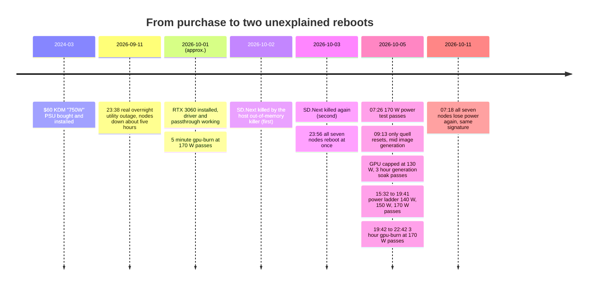
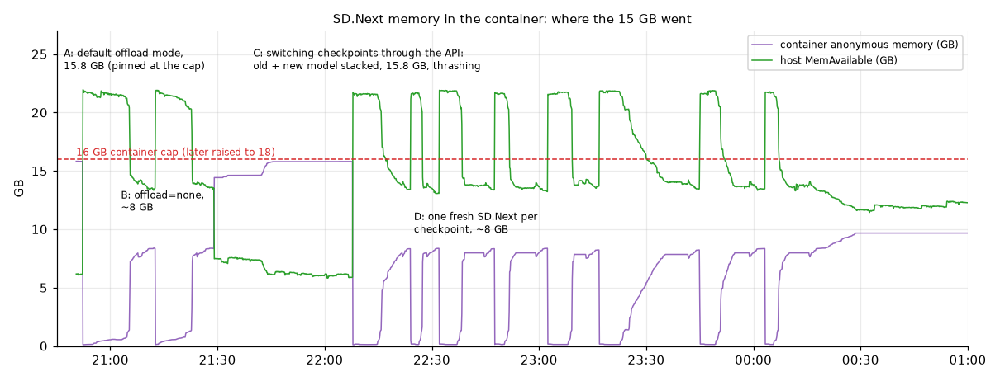
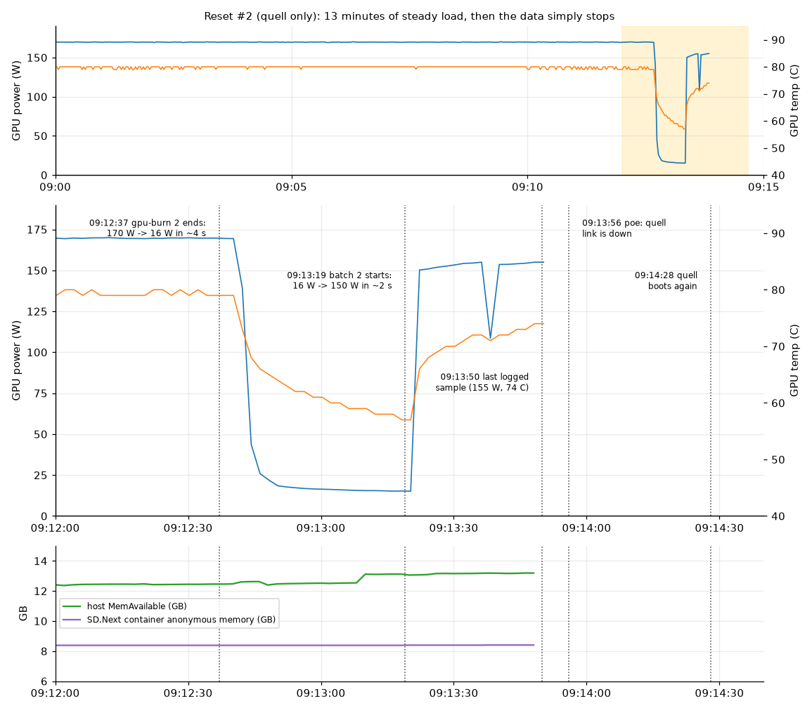
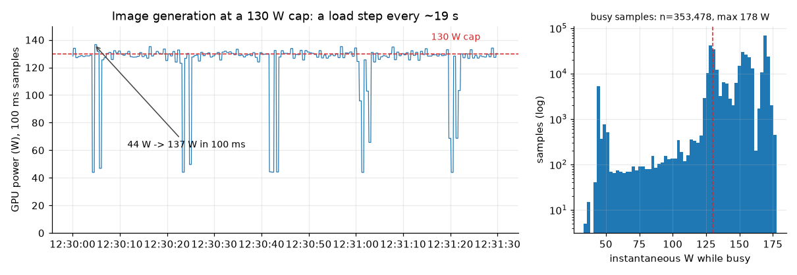
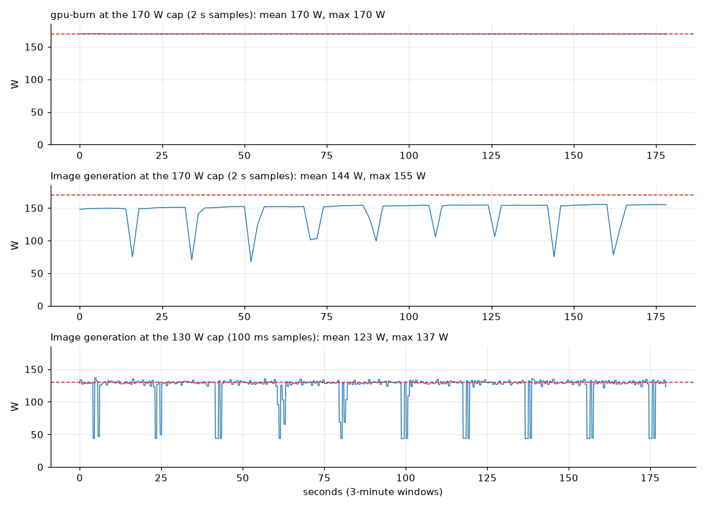
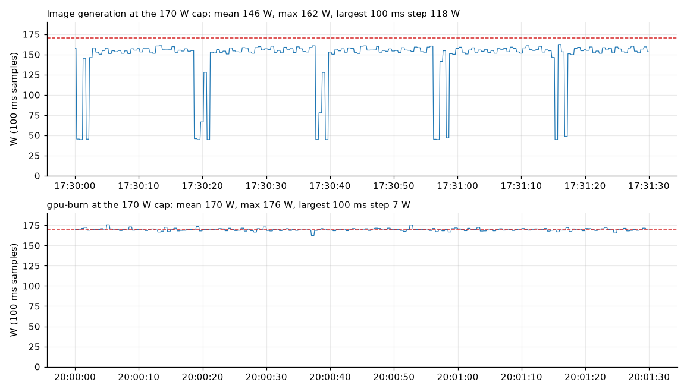
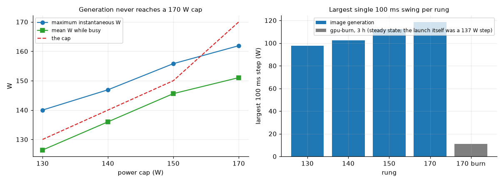
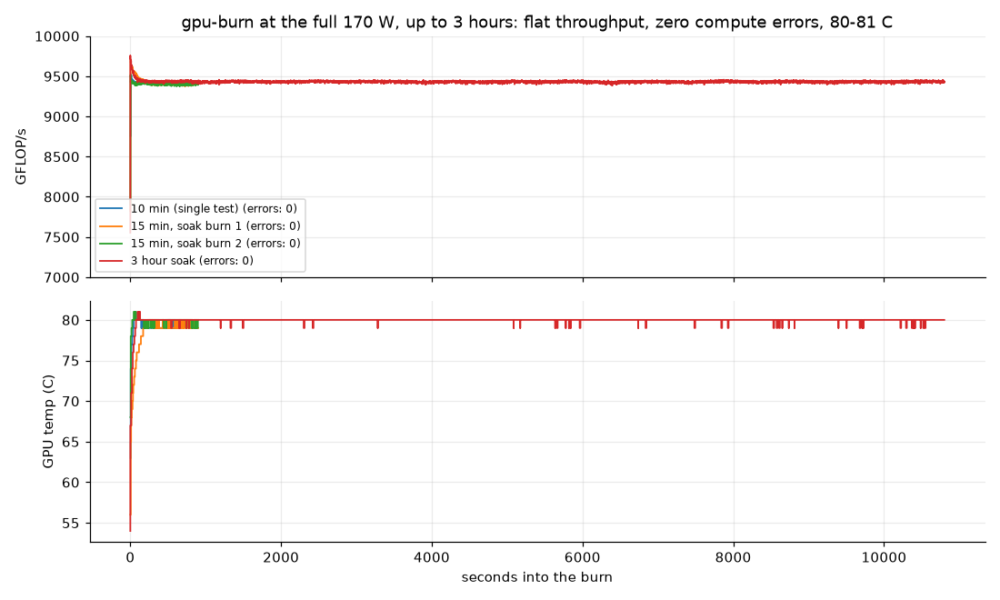
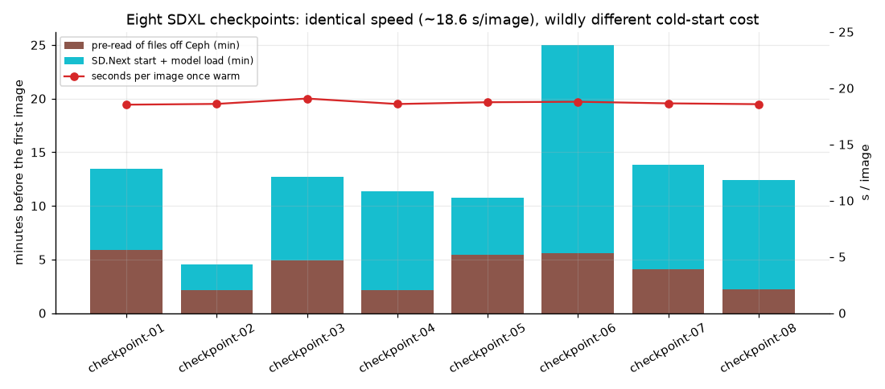
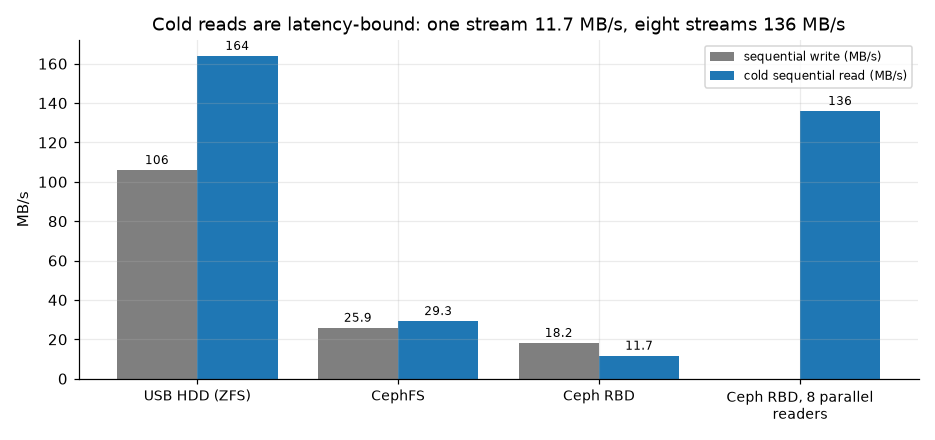

<!-- DRAFT STATUS: unresolved, but the full power ladder and the 3 hour gpu-burn at 170 W have now finished (2026-10-05 22:42) and are written up below. OG image not generated yet: run `python3 bin/generate-og-images.py --slug used-rtx-3060-cheap-psu-and-two-unexplained-reboots` once it is a post. Re-check the "Status" box before publishing.
     Items marked [AUTHOR] need a decision or a personal detail only you have. Rebuild every figure with
     assets/data/gpu-psu-rtx3060/refresh_from_quell.sh. -->

A while back I [bought a $60 "750W" power supply]() so one Dell OptiPlex 990 in my Proxmox cluster could someday host a real GPU. The GPU finally arrived: a used RTX 3060 12GB from eBay. This is the log of what happened next. It ends, so far, with two reboots I cannot yet explain, a stack of evidence, and a more honest understanding of how little a "passed the stress test" result can mean.

<!-- excerpt-end -->

<!-- [AUTHOR: confirm the RTX 3060 install date in the timeline below; 2026-10-01 is approximate] -->

> **Status (2026-10-05, late evening): unresolved, and the reset did not reproduce.** The node reset once on its own during image generation at the card's full 170 W, and a different, cluster-wide reset happened two days earlier. I then ran about 3 hours of image generation at 170 W (600 images) and a 3 hour `gpu-burn` at 170 W, plus a stepped ladder from 130 W up: no reset, no PCIe error, no throttle flag, no wrong pixel. That is evidence against a steady-load limit and against a gross fault, but one reset in roughly 45 minutes is too small a sample to call anything safe. Both the PSU and the used GPU remain suspects.

> **Update (2026-10-11): the cluster-wide reset happened again.** At about 07:18 on Sunday 2026-10-11 all seven nodes lost power together a second time, eight days after the first, with the same signature and a clean recovery. Together with a confirmed utility outage on the night of 2026-09-11/12, that makes the cluster-wide events very likely a power-delivery problem; see [the second cluster-wide event](#the-second-cluster-wide-event-2026-10-11). It does not explain reset #2, which hit `quell` alone. [AUTHOR: the title still says two unexplained reboots; the cluster-wide one now has a likely cause, so consider retitling.]

## The build

| Part | Detail |
|---|---|
| Node | Dell OptiPlex 990 mini tower, Intel Core i7-2600 (2011), 32 GB RAM, BIOS A24 (2018) |
| Role | One of seven Proxmox nodes in a Ceph cluster, named `quell` |
| PSU | KDM/MIPC drop-in "750W" for OptiPlex 9010/990/790, **$59.65**, ordered about March 2024 (return window closed 2024-04-06). The listing's own specifics say "Maximum Power 775W" |
| PSU rails | Two +12V rails at 24 A each, two PCIe 6+2 leads, claimed OCP/OVP/UVP/SCP/OPP protections |
| GPU | Used NVIDIA GeForce RTX 3060 12 GB from eBay. 170 W default and maximum power limit, 100 W minimum |
| Slot | PCIe 2.0 x16 (the card could do Gen 4; the 2011 platform tops out at Gen 2) |
| GPU power cable | A single cable from the PSU to the card, nothing else on that lead, 8-pin firmly seated |
| Workload | An LXC container (`agent-gpu`) with the GPU passed through, running Ollama, SD.Next and ComfyUI |

One number deserves a second look. Two 24 A rails is at most 2 x 24 A x 12 V = **576 W** on the 12 V side even with both fully loaded, so a "750W" label is a combined or peak figure rather than 12 V capacity, and a single rail tops out near 288 W. That still covers a card that averages 150 W. It says nothing about how a $60 unit handles short spikes.

## Timeline



## The pain points before the reboots

The reboots are the headline, but most of the time went into smaller problems. Each of these cost real hours.

| Problem | What was actually wrong | Fix and lesson |
|---|---|---|
| GPU nodes missing after reboot | `/dev/nvidia-uvm` is not created until something asks for it | A small boot-time service runs `nvidia-modprobe -c 0 -u`. Check device nodes after every reboot |
| CUDA toolkit would not install | The vendor's Debian 12 repo key is SHA1-signed, which Debian 13's apt rejects; the Debian 13 repo only has CUDA 13.1+, newer than the 13.0 the driver supports | Skip the system toolkit. PyTorch bundles its own CUDA runtime |
| Ollama installed on the Proxmox host | `pct exec 604 -- curl ... \| sh` runs the pipe on the **host's** shell, not in the container | Wrap it: `pct exec 604 -- bash -c 'curl ... \| sh'`. Cleaned up the host afterwards |
| Ollama silently CPU-only | The installer needs `pciutils` to detect the GPU and only prints a warning | Install `pciutils` first |
| Web UIs unreachable | Ollama bound to loopback, and Open WebUI had never actually been run as a service | `OLLAMA_HOST=0.0.0.0` and a real systemd unit |
| Open WebUI and aider crash-looping | Python 3.13 removed the standard `audioop` module that their audio dependency imports | `audioop-lts` in each tool's own virtualenv |
| AUTOMATIC1111 would not install | Its hard-coded upstream repo was deleted in December 2025, and every dependency URL is overridable with no integrity check (an open upstream issue) | Switched to SD.Next |
| Corrupted model downloads | A resumed `curl -C -` appends, and an orphaned first download was still writing to the same file | Compare the safetensors header's expected size, then verify SHA256. Never resume into an existing file |
| Some model downloads returned 401 | Certain model hosts require a logged-in account to download | An API key as a bearer token |
| Model loads took minutes | A cold read off Ceph was ~12 MB/s with one stream, ~136 MB/s with eight parallel readers (figure 7) | Pre-read files with parallel `dd` before loading |
| Host killed SD.Next twice | By default SD.Next keeps a CPU copy of the model (~15.4 GB resident); the host only has ~18 GB spare beside its Ceph daemons | `diffusers_offload_mode: none` brought it to ~8 GB (figure 5) |
| Container would not autostart after a reset | Stale RBD locks plus ext4 multi-mount protection delay the root filesystem ~90 s, and the host's CephFS mount arrives after PVE has already given up | A boot-time retry service that waits for Ceph and the mount (not yet proven in a real boot) |
| Physical clearance | The card's length conflicted with the SATA cabling | [AUTHOR: confirm what you ended up doing; the plan was 90 degree SATA cables before resorting to a PCIe riser] |


*Figure 5: the container's anonymous memory. A is the default offload mode pinned at its 16 GB cap; B is `offload=none` at about 8 GB; C is the hump from switching checkpoints through the API (old and new model stacked); D is one fresh SD.Next per checkpoint.*

## Reboot #1: all seven nodes at once

At 23:56 on 2026-10-03, while the GPU was running a benchmark, `quell` rebooted. For a day I treated it as a quell fault. It was not.

Pulling the boot history from every node showed that **all seven nodes rebooted within about 20 seconds of each other**:

| Node | Previous boot ended | New boot started |
|---|---|---|
| edgar | 23:56:00 | 23:57:04 |
| harlan | 23:56:01 | 23:57:05 |
| poe | 23:56:10 | 23:57:07 |
| kovacs | 23:56:17 | 23:57:17 |
| quell | 23:56:20 | 23:56:57 |
| tanaka | 23:57:21 | 23:58:03 |
| jaeger | 23:57:21 | 23:58:17 |

Ceph's own cluster log agrees: the monitor's message counter restarts near 580 and the metadata server goes into `up:replay`, because every monitor, OSD and MDS restarted together.

What this does and does not tell me:

- It is **not** a fault local to one node's GPU or PSU: seven machines with different power supplies, and only one of them had a new GPU.
- poe's journal shows no network, quorum or fencing messages before it ended, but journald can lose the last minute or more, so that is not conclusive.
- The nodes have **no UPS**, and the one small UPS that does exist (below) is not networked, so nothing logs the incoming power and no log can say what the mains did.
- My best explanation, and the most likely one, is a **brief power interruption on the line feeding the house**: I suspect a tree limb on the power line, though I have no utility outage report to confirm it. Seven machines with no ride-through losing power together and booting again within a couple of minutes (each node's BIOS, disks and Ceph start-up add their own delay, which is why the boot times spread over about 80 seconds) fits that far better than any software cause.
- A separate Wyse 3040 thin client on the same LAN **did not** reboot (it has been up since September 12). That is explained by what it is plugged into: a small non-networked ("dumb") UPS that also carries the Google Wifi, the HP ProCurve 2500 switch and the Google Fiber router and fiber device. The nodes are not on it. So the network and the thin client rode through while the nodes dropped; what that does and does not prove is below.

I cannot prove this from software alone, and the lesson is simple: a cluster with seven machines and no UPS will lose its Ceph quorum to the next flicker as well. It did, eight days later (next sections). A UPS would also be the first thing to log the input voltage that this post is missing.

## Reboot #2: only `quell`, mid-generation

At about 09:13:50 on 2026-10-05, `quell` alone reset. This time I had a 100 ms GPU power log, a memory log and a live copy of both streamed to another machine.


*Figure 3: the last minutes before reset #2. The load had been a steady 170 W burn; it dropped to idle in about 4 seconds, sat idle for roughly 40 seconds, then jumped to about 150 W when image generation began. The log ends at 09:13:50 at 155 W and 74 C.*

The evidence:

- The last logged sample (09:13:50) is **155 W at 74 C, 100% load**. Nothing was ramping or overheating.
- Host memory had **13.8 GB** free and SD.Next was using 9 GB, so this was not memory pressure.
- Another node's corosync log recorded `quell` losing its link at **09:13:56** with no fencing or watchdog message, and rejoining at 09:14:53. It vanished instantly rather than hanging first.
- The persistent journal's last entry was **09:13:20**, about 30 seconds *before* the real end. **A persistent journal can lose the last seconds before a crash**, which is exactly when you need it. That is why I stream logs to another machine now.
- No GPU error, PCIe error or machine-check message appears anywhere that survived, and the GPU's PCIe error counters read zero.

```text
poe corosync[1612]: [KNET ] link: host: 6 link: 0 is down            09:13:56
poe corosync[1612]: [QUORUM] Sync left[1]: 6                         09:14:07
poe corosync[1612]: [KNET ] link: Resetting MTU for link 0 because host 6 joined   09:14:53
```

## The second cluster-wide event: 2026-10-11

Eight days after the first, it happened again. At about 07:18 on Sunday 2026-10-11 all seven nodes lost power together and booted again within about 85 seconds of each other. I found it at 08:51 from the boot histories, the same way I found the first one. This time I could compare it with the first event instead of reasoning from a single data point.

| Node | Previous boot ended | New boot started |
|---|---|---|
| kovacs | 07:18:10 | 07:19:59 |
| poe | 07:18:20 | 07:19:44 |
| harlan | 07:18:31 | 07:19:45 |
| edgar | 07:18:32 | 07:20:04 |
| quell | 07:18:41 | 07:19:28 |
| tanaka | 07:19:23 | 07:20:28 |
| jaeger | 07:19:24 | 07:20:52 |

What the second event adds:

- **The same signature.** No node recorded a shutdown (`last -x` shows a new boot with no shutdown entry before it), and on poe and edgar, the two journals I read, the last lines are ordinary `sudo` and Telegraf entries. Recovery was clean without intervention: the monitors regained quorum after two elections, all 28 OSDs came back, the metadata server went active, the ZFS root pools I checked were healthy and HA reported no errors.
- **Seven supplies, one new GPU.** Two cluster-wide events cannot be blamed on the `quell` GPU or its $60 supply. Whatever caused them reached seven machines with different power supplies at once. That narrows the "bad PSU" suspect to reset #2 only.
- **The order repeats.** In both events the journals of the first five nodes ended within about 30 seconds of each other, `quell` was the last of those five (not the first to go), and `tanaka` and `jaeger` stopped logging roughly a minute after the rest. I do not have an explanation for that order and my guess is journal flush timing, but a repeat is more consistent with one external cause than with a fault on any single machine.
- **The thin client was on a UPS the whole time.** The Raleigh Wyse 3040 shares one small non-networked UPS with the Google Wifi, the HP ProCurve 2500 switch and the Google Fiber router and fiber device. Its boot history shows one boot on 2026-09-12 and the next at 02:00 on 2026-10-19, a scheduled upgrade reboot, so it did not restart on 10-03 or 10-11: the UPS bridged both interruptions. It did go down in the long outage below and came back with the nodes, which is what a small battery does when an outage outlasts it. Two things follow. The network was almost certainly up throughout both events, so a switch or router failure is not part of the story: the nodes lost power. And the Wyse cannot tell me whether the rack shares a circuit with that UPS, because the UPS would hide a utility sag from it just as well as a fault on the rack's circuit alone. [AUTHOR: confirm the ProCurve and the fiber gear did not restart on either date, and say whether the UPS beeped or switched to battery at 23:56 on 10-03 and 07:18 on 10-11.]
- **This is not the first outage here.** On the night of 2026-09-11/12 a real utility outage, which I confirmed at the time, took the nodes down for about five hours: the journals on the four nodes whose history goes back that far end between 23:37:50 and 23:38:20 and restart between 04:49 and 04:50, and the thin client returned at 04:49 as well. The power lines here are above ground, and storms have knocked the power out before. Two short events a week apart fit a marginal line, though I have no utility report for either.

I still cannot separate a sag on the utility feed from a fault on the circuit or power strip that feeds the rack, because nothing here logs the input voltage. The same two cheap steps test both: a UPS that reports input voltage, and tracing what else shares that circuit. None of this explains reset #2. `quell` reset alone, at 155 W and 74 C with nothing else on the line failing, which is why the PSU and the card stay on the suspect list below.

## Measuring power at 100 ms

The GPU exposes its instantaneous power draw. Sampling it every 100 ms shows something a 2-second log hides:


*Figure 1: image generation at a 130 W cap. Power swings from about 130 W to about 45 W and back at every image boundary, roughly every 19 seconds. Across 58,623 busy samples the maximum was 140 W and nothing exceeded 145 W.*

The bigger point is how different the workloads look electrically:


*Figure 2: `gpu-burn` at the 170 W cap is a flat line. Image generation, at either cap, is a repeating cycle of high draw and sharp dips (the 2-second samples in the middle panel understate the true depth).*

Measured so far:

| Setting | Generation power | Notes |
|---|---|---|
| 130 W cap | mean 126 W, maximum 140 W, none above 145 W | 74 C, PCIe link steady at Gen 2 x16, no hardware slowdown flags |
| 140 W cap | mean 136 W, maximum 146.9 W | 76 C |
| 150 W cap | mean 145.6 W, maximum 155.8 W | 79 C |
| 170 W cap | mean 151 W, maximum 161.9 W, never above 170 W | 80 C. Generation simply does not use the whole 170 W, so the cap is not what limits it |
| `gpu-burn`, 170 W cap | mean 169.7 W, maximum 177.7 W, flat | 80 to 81 C, 0 compute errors, about 9,430 GFLOP/s for the whole 3 hours (figure 4) |

At every cap the card overshoots the limit by roughly 6 to 8 W for a 100 ms sample or two. The 100 ms data at 170 W, where the node reset, is what I was missing in the first draft of this post, and it is unremarkable:


*Figure 8: the same 170 W cap, two very different loads. Generation sits near 155 W and drops to about 45 W between images; `gpu-burn` is a flat line on the cap with a largest 100 ms step of 7 W.*


*Figure 9: the ladder. Peak and mean power rise with the cap until generation tops out near 162 W. The largest 100 ms swing grows slowly with the cap (98 W at 130 W, 118 W at 170 W) and then stops growing, because it is set by the card dropping to idle between images, not by the cap.*


*Figure 4: four `gpu-burn` runs at the full 170 W, the longest 3 hours. Throughput is flat from the first minute to the last and the compute-error count stays at zero.*

## What I got wrong

This is the part I most want to record, because each wrong turn felt well supported at the time.

1. **"It was a memory stall."** After the first node-only reset I blamed SD.Next's memory use. The data killed that: at the second reset the host had 13.8 GB free.
2. **"Both resets were `quell` at 170 W."** The first was cluster-wide, found only because I finally pulled boot history from every node instead of just the one under suspicion.
3. **"`gpu-burn` never triggered it, so it is a load-step problem."** Counting the hours says otherwise:

| Load at 170 W | Time before reset #2 |
|---|---|
| `gpu-burn` | about 45 minutes (5 + 10 + 15 + 15) |
| Image generation | about 45 minutes (about 14 images before reset #1, about 133 before reset #2, at about 18.6 s each) |

   Equal exposure, one reset in the generation hours and none in the burn hours. That was statistically empty: **`gpu-burn` had simply not run long enough to say anything, in either direction.** I fixed that afterwards with a 3 hour burn at 170 W, which came back clean (below). It narrows the picture, but a 3 hour clean run only means something against a failure that happens at least every few hours.
4. **"It survived 3.5 hours at the 130 W cap."** That was wall-clock time dominated by waiting for model loads off a cold Ceph cluster. The GPU was only generating for about 15 minutes of it. The honest 130 W exposure is the dedicated generation soak I ran afterwards: 600 images, about 3 hours of real generation, clean.

The lesson I am taking away: **count the hours of each load, not the wall-clock time, before concluding anything is safe.**

## Why image generation as the test, and what it cannot show

I use image generation as the main test vehicle for four reasons:

1. The node-only reset happened in it.
2. It is the real workload the machine exists for.
3. It has a different electrical character from `gpu-burn`: a ~100 W swing about every 19 seconds, with the CPU, disk and network busy at the same time, where `gpu-burn` is a flat load with an idle CPU.
4. It has a built-in correctness check. Generation is deterministic, so every tenth image uses a fixed seed and is compared pixel-for-pixel with a reference. A mismatch would mean the GPU computed something differently, which is how silent corruption from a marginal card or supply would show up.

The honest caveat: it was also chosen partly because it was already running, so the comparison with `gpu-burn` is **not** a controlled one. A proper test is a 2 x 2 grid of {`gpu-burn`, image generation} x {130 W, 170 W} with a few hours in each cell. Counting only real load time on the card, the grid now looks like this:

| | 130 W cap | 170 W cap |
|---|---|---|
| Image generation | about 3 h, clean (600 images) | about 3 h 45 min: **one reset** at about 45 min, then 3 h clean (600 images) |
| `gpu-burn` | not run | about 3 h 45 min, clean (45 min before the reset, then 3 h) |

The reset is the only event in roughly 11 hours of load, and it happened in the first 45 minutes of generation at 170 W. I could not make it happen again. The ladder (140 W, 150 W, 170 W) ran with guards that would have backed the cap off to 130 W on any new PCIe error counter, any hardware slowdown or power-brake flag, a link width below x16, a wrong canary pixel or a failed image. None fired.

## Suspects

| Hypothesis | For | Against | What would test it |
|---|---|---|---|
| **PSU spike or over-current handling** ($60 unit, ~2.5 years old) | Instant loss with no logs fits a power-good glitch; one node reset in generation | No voltage sensor to see it; 3 h of generation and 3 h of `gpu-burn` at 170 W clean, with nothing above 178 W at 100 ms | A known-good PSU; a wall-power meter |
| **A bad GPU** (used, from eBay) | Bought used | 0 compute errors over well over 1,500 images and about 3.75 hours of burn, 0 canary mismatches, 0 PCIe errors, no driver error | The card in another machine, or a swap |
| **Mains interruption or the rack's circuit** (reset #1 and the 2026-10-11 event) | All seven nodes at once, twice in eight days, the same signature both times, no UPS on the nodes, a confirmed real outage on 2026-09-11/12 | No utility report for either short event; the small UPS that carried the Wyse and the network gear through both would equally hide a fault that only touches the rack's circuit | A UPS that logs input voltage; tracing what else shares the rack's circuit; whether the existing UPS beeped at those times |
| **The 2011 platform** (board, voltage regulators, BIOS) | Age | Nothing specific | A CPU-only stress test |
| Memory pressure | | Host had 13.8 GB free | ruled out for reset #2 |
| Overheating | | 74 C, cooler than during the burns | ruled out |
| GPU compute errors | | `gpu-burn` 0 errors, canary identical | ruled out so far |

I am keeping the PSU and the GPU equally suspect until one is proven. The PSU being "oversized for the average draw" does not rule out transients or cabling, and the card being used does not rule out the supply.

## Tests

**Done**

| Test | Result |
|---|---|
| `gpu-burn`, 5 min, 170 W (day one) | OK, 0 errors, ~9,400 GFLOP/s, 80 C |
| `gpu-burn`, 10 min, 170 W | OK, 0 errors |
| 30 images at 170 W | 18.51 s each; output pixel-identical to the 130 W output; mean 150 W, peak 157.5 W |
| Mixed soak at 170 W: 15 min burn, 100 images, 15 min burn, then a second batch | Both burns OK, batch 1 clean (100/100, 0 canary mismatches), then **reset #2 about 30 s into batch 2** |
| Generation soak at a 130 W cap: 6 batches of 100 images, 100 ms power log, PCIe error counters, live-streamed | 600 images, 0 failures, 0 canary mismatches, maximum 140 W, 74 C |
| Stepped ladder at 140 W, 150 W and 170 W (100, 100 and 600 images) with automatic back-off to 130 W on any indicator | 800 images, 0 failures, 0 mismatches, 0 PCIe errors, 0 hardware-slowdown samples, maximum 161.9 W, 80 C |
| `gpu-burn` at 170 W, 3 hours | GPU OK, 0 compute errors, 9,433 GFLOP/s average, maximum 177.7 W, 81 C, 0 PCIe errors |

**Proposed** (none of these has been done)

| Test | Why |
|---|---|
| CPU-only stress, 1 to 2 hours | Separates the platform from the GPU |
| Wall-power meter during generation and burn | The only way to see what the supply actually delivers |
| Known-good PSU swap | The decisive test; I have no spare at this rating |
| GPU in another machine | The decisive test for the card |
| A UPS on `quell` first (spares are on hand), later reporting to a NUT server on a spare Wyse 3040 (not built yet), then the whole rack | Protects the Ceph OSDs, and is the only way to log mains events: it would also show whether reset #2 was a sag that only the most heavily loaded node could not ride through |
| Check the card's eBay return window | [AUTHOR: if it is still open, finish the decisive tests before it closes] |

## What else the GPU is for

The point of all this is a working GPU. I compared eight SDXL-architecture checkpoints, labelled `checkpoint-01` to `checkpoint-08` in the order I tested them, generating the same prompt with the same four seeds on each. They all generate at the same speed, about 18.6 seconds per 1024 x 1024 image at 25 steps, because they share one architecture, and they are all about the same size:

| Checkpoint | File size | Precision | Cold start (pre-read + start + load) | Warm time per image |
|---|---|---|---|---|
| checkpoint-01 | 6.94 GB | fp16 | 13 min | 18.5 s |
| checkpoint-02 | 7.11 GB | fp16, plus about 0.33 GB of fp32 tensors | 5 min | 18.6 s |
| checkpoint-03 | 6.94 GB | fp16 | 13 min | 19.1 s |
| checkpoint-04 | 6.94 GB | fp16 | 11 min | 18.6 s |
| checkpoint-05 | 6.94 GB | fp16 | 11 min | 18.7 s |
| checkpoint-06 | 6.94 GB | fp16 | 25 min | 18.8 s |
| checkpoint-07 | 6.94 GB | fp16 | 14 min | 18.6 s |
| checkpoint-08 | 6.94 GB | fp16 | 12 min | 18.6 s |

Each one occupies about 7.1 GB of the card's 12 GB when loaded (measured on one; the rest share the architecture), so one model fits comfortably with room for the working buffers, and switching means a full reload. What differs enormously is the cold-start cost of that reload, from about 5 to 25 minutes depending on the state of the file cache:


*Figure 6: pre-read time and start-up time for each checkpoint, against a flat per-image time.*


*Figure 7: sequential speeds measured with `dd` on the same node. A cold read off Ceph is latency-bound: one stream manages 11.7 MB/s, eight streams 136 MB/s.*

## Data and reproducibility

Everything above is backed by files in this repository:

- Raw, sanitized measurement logs (gzipped): [`assets/data/gpu-psu-rtx3060/raw/`](https://github.com/mcgarrah/mcgarrah.github.io/tree/main/assets/data/gpu-psu-rtx3060/raw)
- Journal, cluster and boot-history evidence for both resets: [`evidence/`](https://github.com/mcgarrah/mcgarrah.github.io/tree/main/assets/data/gpu-psu-rtx3060/evidence)
- The load-exposure table: [`processed/exposure_estimate.md`](/assets/data/gpu-psu-rtx3060/processed/exposure_estimate.md)
- The soak, power-ladder, image-batch and boot-retry scripts: [`scripts/`](https://github.com/mcgarrah/mcgarrah.github.io/tree/main/assets/data/gpu-psu-rtx3060/scripts)
- One command rebuilds every figure from the raw logs: `assets/data/gpu-psu-rtx3060/build_assets.py`

## What is next

Everything I can do in software is now done, and it leaves the question open: the node reset once at 170 W and then ran about six hours at 170 W without a hiccup. The live-streamed 100 ms logs were in place for all of it, so if it resets again I will have the last seconds of GPU data, kernel log and PCIe counters from outside the machine.

What can actually separate the suspects is hardware: a known-good PSU, the card in another machine, and a wall-power meter on the node. A CPU-only stress test would rule the platform in or out. Until then, the card runs at a 130 W cap, which costs nothing measurable for image generation (the same 18.6 seconds per image at 130 W and at 170 W).

### Power protection comes first

Reset #1 and the 2026-10-11 event are almost certainly the same problem on the mains or the rack's circuit, and it will hit again the next time something touches the line: seven machines, no UPS, and a Ceph cluster that loses its quorum and restarts every OSD at once. It is also the missing instrument for reset #2. A UPS that reports its input voltage is the only thing that can tell me whether `quell` was handed a brief sag that six lighter-loaded nodes rode through.

None of it is built yet, but the plan and most of the hardware are there:

- **What is already protected (a non-networked UPS).** The Google Wifi, the Wyse 3040 at Raleigh, the HP ProCurve 2500 switch and the Google Fiber router and fiber device share one small UPS with no data connection, and it held through both short events. It is why the network stayed up while the nodes dropped. Because it cannot report anything it is not a NUT source, and the nodes remain the unprotected part.
- **A dedicated NUT server (planned).** The design is a spare Wyse 3040 thin client running Network UPS Tools (NUT), with the UPS plugged into it by USB so the whole network can read it on TCP port 3493. The Wyse is not set up yet and NUT is not installed anywhere.
- **Spare UPS units (on hand).** I have several, enough to cover minor power problems while a proper rack-sized one is sorted out. `quell` gets one first, since it carries the heaviest load on the cheapest supply.
- **A client on every node (planned).** The baseline is NUT's `nut-client` (the `upsmon` daemon) on each Proxmox node, pointed at the Wyse, so that every node shuts down cleanly when the battery runs low and logs when it goes on battery.
- **PVE-UPS on top (planned).** The community-scripts [PVE-UPS](https://community-scripts.org/scripts/pve-ups) helper installs a small web dashboard in a Proxmox container that reads either SNMP or an existing NUT server and, on an outage, shuts the Proxmox hosts down with retries. It is one appliance for the cluster rather than something to install on each node, and it needs a Proxmox API token with the `Sys.PowerMgmt` privilege, so it only makes sense once the NUT server exists.
- **PeaNUT for reporting (planned).** The community-scripts [PeaNUT](https://community-scripts.org/scripts/peanut) helper adds a web dashboard on top of NUT and shows every UPS the NUT server knows about in one place, which matters with several units keeping the cluster up. It also has a Homepage widget, so the UPS state can sit on the same dashboard as everything else. It only reports; the shutdown logic stays with `nut-client`.

Until the Wyse is built, a spare UPS on `quell` still protects it from a flicker, but nothing records what the mains did.

None of this is tested yet: the first real test is pulling the UPS plug on purpose and watching the nodes shut down in order, with Ceph set to `noout` beforehand so the cluster does not start rebalancing. The payoff for this post is the log: the next time the voltage dips, the UPS will say so.

*I worked through the diagnosis with Claude Code, which also kept the logs and scripts consistent; the measurements and the mistakes are mine.* [AUTHOR: edit this line to taste]
