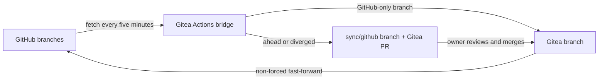

When the internet drops, a Git checkout on my laptop still works. What stops working is everything that checkout expects to reach: the remote, the pull request, the CI job, and the repository another machine on the LAN needs.

I wanted a local copy of my GitHub repositories that remains useful when the public network is unavailable. I also wanted to work from the LAN-only machines in my homelab without giving every one of them a GitHub credential. That sounds like a mirror, until both copies change. Then the question is not how to copy files. It is how to keep two histories moving without silently replacing one with the other.

The design I settled on puts Gitea on the LAN, keeps GitHub as an upstream and off-site copy, and uses a small Actions workflow to move branch updates in both directions. A GitHub-only branch can be copied to Gitea; updates to an existing branch are staged for review when they cannot be fast-forwarded safely. Outbound updates are fast-forward-only. When the histories disagree, automation stops and asks for a decision.

<!-- excerpt-end -->

## The LAN needs a Git service of its own

Some machines in this environment can reach the LAN but cannot reach GitHub. Even when a workstation has a local clone, that does not help another system that needs to clone a repository, fetch a branch, or review a change. A LAN Git service gives those clients a nearby endpoint and keeps routine Git access separate from the GitHub credential used for synchronization.

Git is a good fit for this problem because every clone contains history, not just the current files. The local service can serve existing commits and accept new ones without a connection to GitHub. When public connectivity returns, the sync workflow can move changes between the two services.

I chose Gitea because it provides Git hosting, pull requests, and Actions-compatible workflows in one service. The production instance runs in a Proxmox LXC; a separate LXC runs the Actions worker. Gitea's data lives on a dedicated Ceph RBD volume, with the service managed for Proxmox HA. That gives the LAN a stable endpoint while keeping workflow execution away from the Gitea database and configuration.

The worker is deliberately small and handles one job at a time. It is registered for the `gh` organization, which contains repositories that synchronize with GitHub. The plan reserves a separate `lab` organization for local-only repositories; workflows there must not be able to read the GitHub sync credential. A workflow runner executes repository code, so its organization and secrets are security boundaries, not labels for tidiness.

## Two-way sync needs a review path

A built-in push mirror is attractive until someone changes the GitHub copy while a local change is waiting to go out. A force push can make the mirror look current by discarding history. I wanted a workflow that could move a one-sided update automatically but would stop when both sides had something to contribute.

The bridge checks all branches on a five-minute schedule. A push to the Gitea default branch also starts a sync run. A Gitea-only branch is created on GitHub. For a branch that exists on both sides, Gitea advances GitHub only when the GitHub tip is an ancestor of the Gitea tip. The push is a normal, non-forced Git push. If GitHub moved at the same time, the push is rejected instead of overwriting that update.

For inbound changes, a GitHub-only branch can be copied to Gitea. If GitHub advances a branch that already exists in Gitea, or the two sides diverge, the bridge updates a reserved `sync/github/<branch>` review branch and opens or updates a Gitea pull request. It leaves both canonical branch tips alone until a person reviews and merges the PR.



The merge method matters. An inbound PR must be merged with a merge commit that keeps the GitHub tip in the resulting ancestry. The next sync can then fast-forward that exact history back to GitHub. Squashing or rebasing the PR would rewrite the incoming commits and break that safe return path. If the bridge encounters rewritten history, a rejected push, or a conflict in its review branch, it stops for a person to inspect both sides. It never merges, rebases, deletes branches, or force-pushes on its own. Tags and branch deletions are outside this bridge's scope.

That policy is intentionally conservative. I would rather receive a review request than discover that a synchronization job decided which copy of my work mattered.

## The worker holds the credential, not every client

The GitHub token is stored as a Gitea Actions secret and passed to the sync job. It does not live in repository URLs, local `.git/config` files, or the LAN clients. The bridge uses an ephemeral Git credential helper while it talks to GitHub, so the token is not written into the repository's remote configuration.

Gitea's own job token is used for the API call that creates or updates pull requests. The worker reaches that API through the LAN's HTTPS reverse proxy and verifies its local certificate authority. The sync workflow also sends a failure notification through the existing mail relay; that path has been tested.

The current pilot uses an organization-level GitHub Actions secret in `gh`. That makes the secret available to repositories in that organization, so adding a new repository there also expands the set of workflows that could access it. Before broadening the pilot, I want to move the PAT to repository-level secrets or establish another narrow boundary. The `lab` organization must remain outside that credential scope.

Gitea Actions is running the sync workflow on the worker. It is not running every GitHub workflow. For example, the blog's existing GitHub workflows target a GitHub-hosted `ubuntu-24.04` runner; they are not automatically reproduced by this host-mode worker. The current Gitea workflow registry contains the synchronization workflow, which is the intended scope of this pilot.

## What the pilot has proved so far

The first repositories in the pilot are `k8s-proxmox`, `mcgarrah.github.io`, and `resume`. The live tests exercised both directions. A Gitea-only commit reached GitHub by fast-forward. A temporary GitHub update was staged on the reserved review branch, merged in Gitea, and then sent back to the GitHub test branch without changing either default branch. The scheduled workflows for the infrastructure and blog repositories also completed successfully, and the recorded branch tips matched on both services at the last validation.

For `mcgarrah.github.io`, syncing a reviewed commit to the GitHub `main` branch is also a production publish: GitHub Pages deploys from that branch. That makes owner review especially important before merging a Gitea change to `main`.

The repository sync is a Git-history workflow. It does not copy GitHub issues, pull request discussions, releases, project boards, or repository settings. Those remain on their respective platforms. Gitea pull requests are the review point for incoming Git changes; they are not a mirror of GitHub's review history.

Owner review is currently a manual step, not an enforced Gitea branch-protection rule. The last sync log also listed an open change to restrict the `resume` workflow's push trigger to the default branch. That reduces the chance that an unreviewed workflow change on another branch can start a job with access to the organization secret. I need to verify that PR's current status before publishing this article.

## Connecting existing WSL checkouts

I already have GitHub checkouts in WSL, and I do not want to edit their remotes just to try the LAN service. A distinct SSH host alias gives WSL a named route to Gitea. The private key stays in WSL; I add only its public half to the `mcgarrah` account in Gitea.

The Gitea SSH endpoint is on port `2222`. Its required SSH username is `gitea`, even though the key identifies the Gitea account as `mcgarrah`. The endpoint does not provide a shell.

```bash
ssh-keygen -t ed25519 -a 64 -f ~/.ssh/id_ed25519_gitea_wsl -C "wsl-gitea"
chmod 600 ~/.ssh/id_ed25519_gitea_wsl
```

Before connecting, I check the Gitea SSH host key against the deployment record and add the verified key to WSL's `known_hosts`. Then strict host-key checking can remain enabled.

One existing `agent-dev` key exposed a policy trade-off: Gitea rejected its 2048-bit RSA public key because the server's RSA minimum was 3071 bits. I lowered the server-wide RSA minimum to 2048 to keep using that key. That setting affects every Gitea account, so it is an exception for an existing key, not the choice for a new WSL key. New client keys should use Ed25519.

```sshconfig
Host gitea
    HostName 192.168.86.225
    User gitea
    Port 2222
    IdentityFile ~/.ssh/id_ed25519_gitea_wsl
    IdentitiesOnly yes
    StrictHostKeyChecking yes
```

An optional Git URL rewrite can redirect existing GitHub remotes for repositories under the `mcgarrah` namespace into the Gitea `gh` organization:

```bash
git config --global url."ssh://gitea@gitea/gh/".insteadOf "https://github.com/mcgarrah/"
```

The rewrite keeps the existing checkout's `.git/config` unchanged, but it changes where Git sends both fetches and pushes for every matching URL. A command such as `git ls-remote https://github.com/mcgarrah/k8s-proxmox.git HEAD` will now test Gitea, not GitHub.

There is one catch for moving between networks. This rule is global, and Gitea is LAN-only. Away from the LAN, Git still rewrites the GitHub URL to the private Gitea address, where it cannot connect. The rewrite is useful when I intentionally want matching checkouts to use Gitea on the LAN; it is not a network-aware failover mechanism.

For a setup that works cleanly on both networks, I can leave `origin` on GitHub and add a separate `gitea` remote to each checkout:

```bash
git remote add gitea gitea:gh/k8s-proxmox.git
git fetch gitea
git push gitea main
```

On the LAN, I use `gitea`; on public networks, I use `origin`. If I want the same Gitea endpoint while away, I need a VPN path back to the LAN. The homelab does not expose Gitea directly to the public internet. If I enable the global rewrite for a LAN session, I can remove it when I want GitHub URLs to resolve directly again:

```bash
git config --global --unset-all url."ssh://gitea@gitea/gh/".insteadOf
```

## A second copy is useful, but it is not the whole backup plan

This design gives me another copy of the Git repositories in a different service and lets LAN clients keep working when GitHub is unreachable. GitHub also retains a copy of the repositories that synchronize there. That helps with loss of access to one platform, but automatic replication can also propagate unwanted changes. It is not a substitute for retained backups.

Gitea's data volume is included in the Proxmox Backup Server job, and a separate nightly Gitea dump is retained on its data volume. The dump includes the database, configuration, and private application data. The deployment notes last recorded a restore drill and a real HA migration test as open, so I need to recheck their status before publication. A backup that has not been restored is an assumption.

The other boundary is the planned local-only `lab` organization. Repositories placed there will not be sent to GitHub and must not get the sync secret. That is useful for experiments or private work that is not ready for a public upstream, but it also means Gitea is the only live repository copy. Its PBS backup and dump retention matter even more for those projects.

The reason for building this is simple: I want GitHub when the internet is available, and I want the LAN to remain a useful development environment when it is not. The bridge keeps those copies close without pretending that concurrent edits can be resolved by a cron job. The next step is to finish the outstanding workflow and recovery checks, then decide which repositories are safe to add to the pilot.

<!--
Editorial checks before publication:
- Confirm the current status of Gitea PR #2 for the resume workflow trigger.
- Confirm branch-protection and credential-scope status in Gitea.
- Recheck backup, HA migration, and restore-drill status.
- Generate the branded OG image and add its path to front matter when ready to publish.
-->
